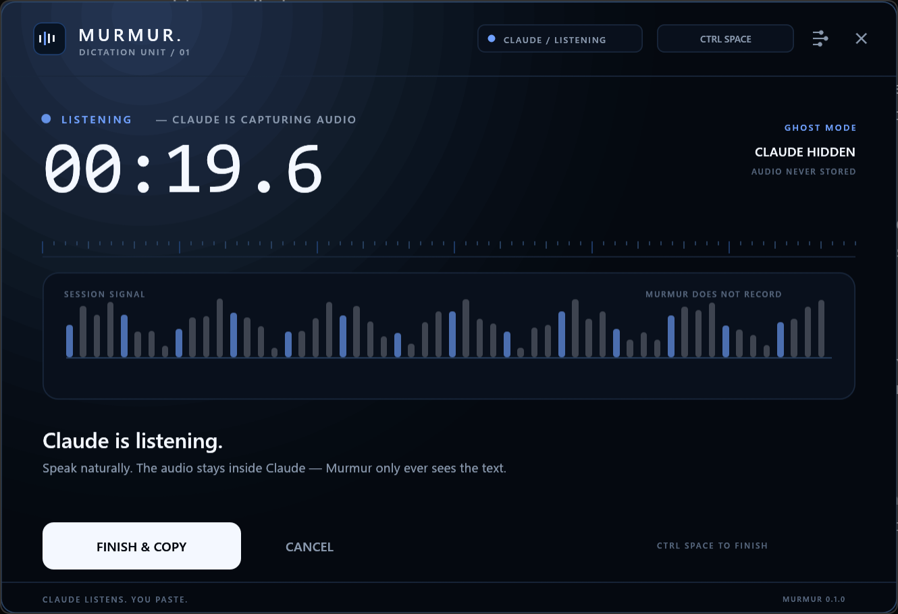
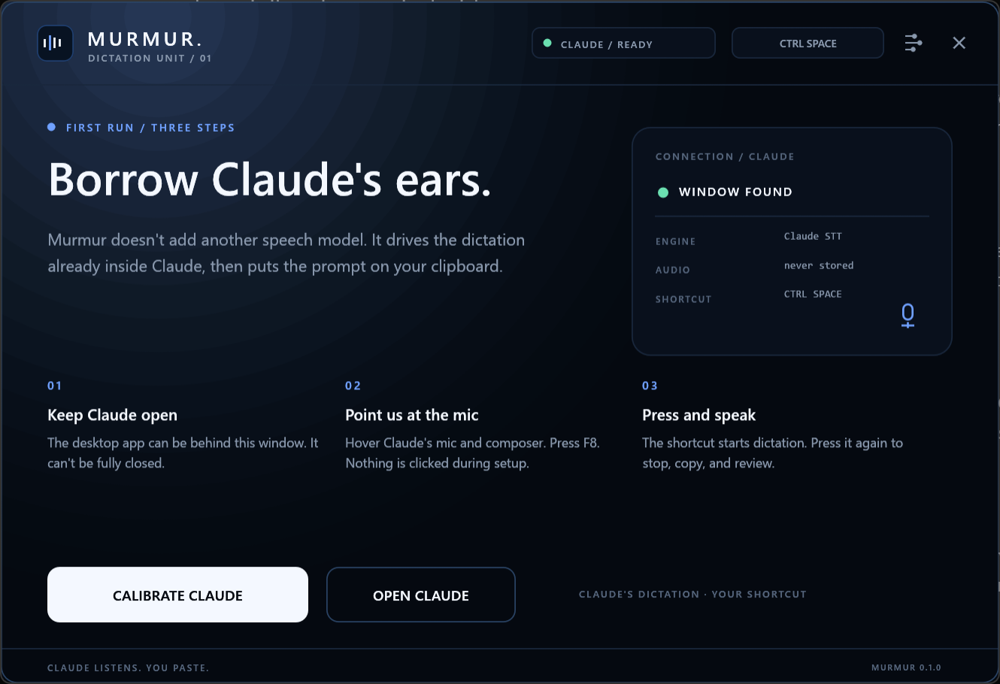
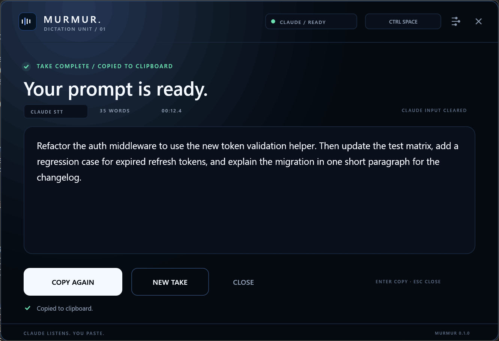
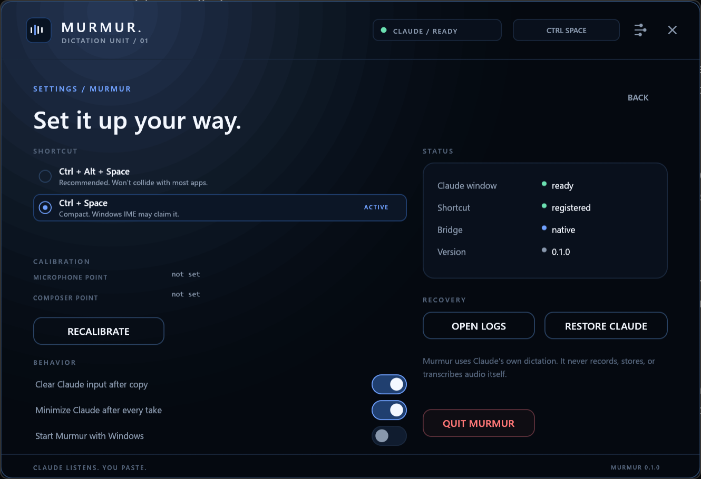
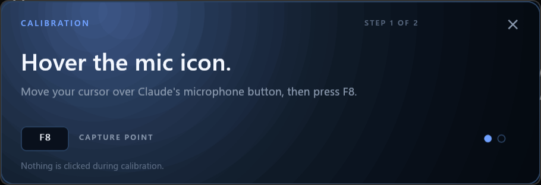
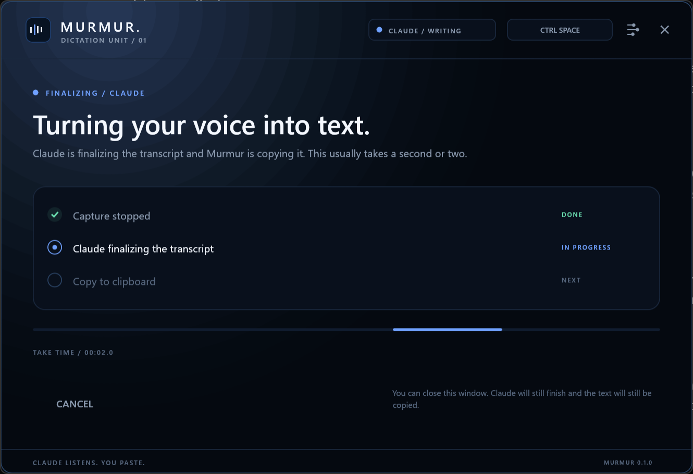
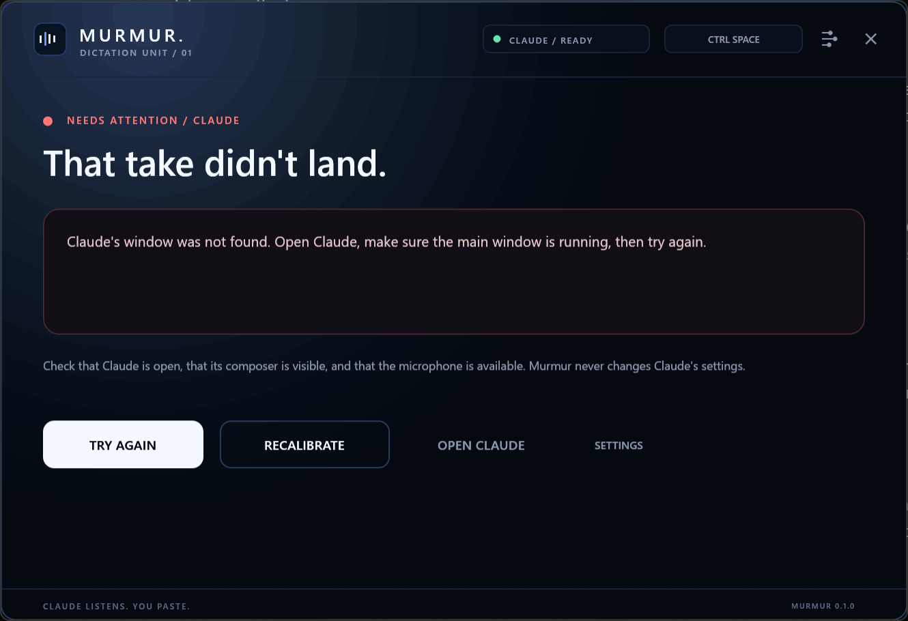

# MURMUR.

**Claude listens. You paste.**

Murmur is a tiny native Windows companion for Claude's built-in dictation. Press
**Ctrl+Space**, speak, press it again. Claude handles the speech-to-text, Murmur
copies the prompt and shows it in a compact instrument panel.

No local speech model. No audio archive. No Electron, Node, or WebView in the
running app.



## Why this exists

Claude's dictation is excellent, but using it from another app means opening
Claude, clicking the mic, speaking, stopping, selecting the text, copying it, and
pasting it elsewhere. Murmur removes that loop:

- one global shortcut
- Claude works invisibly in the background
- the transcript lands on your clipboard automatically
- a small dashboard shows the timer, status, and result

## Quick start

1. Keep the **Claude desktop app open** with its main window running and visible
   for the first calibration. Its built-in dictation must be available (signed in
   with a Claude.ai account and microphone permission granted).
2. Run `release/Murmur/Murmur.exe` (or build it from source).
3. Click **Calibrate Claude**.
4. Hover Claude's **mic button**, then press **F8**.
5. Hover Claude's **composer/text box**, then press **F8**.
6. Press **Ctrl+Space**, speak, and press **Ctrl+Space** again.

The prompt is already on your clipboard when the **Your prompt is ready** screen
appears. Use **Copy again** if another app replaced the clipboard in the meantime.

> Ctrl+Space is free on this machine. If your IME claims it, open **Settings** and
> switch to **Ctrl+Alt+Space**.

## What is implemented

- Native Rust shell with an egui UI rendered through **wgpu / Direct3D 12**
- A 23 KB C# Win32 bridge for the Windows-only automation (no installer, no SDK)
- Global hotkey with a tray icon and a second fallback shortcut option
- Claude window discovery, alpha-ghost hiding, foreground restoration, and crash recovery
- Two-point calibration: microphone icon + composer text box
- Live take timer, animated session signal, and status instrumentation
- Automatic clipboard copy with a second manual copy path
- Optional clearing of Claude's composer after copy
- Optional minimizing of Claude after each take
- First-run onboarding, settings, error states, logs, and "restore Claude" recovery
- Launch-at-login toggle
- Per-monitor DPI awareness and calibrated points stored as normalized fractions
- Preview harness for every UI state (`MURMUR_PREVIEW`)

## Footprint

- Portable executable: **7.9 MB** (7,888,896 bytes)
- Portable zip: **4.8 MB** (includes the screenshots and README)
- Claude bridge: **23 KB**
- No Electron, Node, WebView2, Chromium, Python, or STT model in the app.

The shell uses wgpu/Direct3D 12. On a machine with no hardware D3D12 adapter,
wgpu falls back to WARP, Windows' software rasterizer, which allocates hundreds
of MB. A bare wgpu hello-window test measured ~370 MB working set in this
software-rendered agent session; the full Murmur UI measured ~350 MB, so the UI
itself is negligible. With a hardware D3D12 adapter, wgpu's footprint should be
lower. If guaranteed low memory on a GPU-less VM is a requirement, a CPU-rendered
UI backend is the next optimization step.

> **Testing today?** Follow [`docs/TESTING.md`](docs/TESTING.md) — it is the
> short 5pm checklist for calibration, a real voice take, clipboard, cancel,
> recovery, and window states.

## Screens

| Setup | Listening |
| --- | --- |
|  |  |

| Ready | Settings |
| --- | --- |
|  |  |

| Calibration | Transcribing | Error |
| --- | --- | --- |
|  |  |  |

## How it works

Murmur does not implement dictation. It drives the one Claude already has:

1. Find Claude's main `Chrome_WidgetWin_1` window, even when it is hidden behind
   another window or minimized.
2. Save its placement and the current foreground window.
3. Make Claude invisible with a layered-window alpha, bring it to the foreground
   invisibly, and send a click to the calibrated **mic** coordinate.
4. Show the Murmur overlay without activating it, so Claude keeps focus and keeps
   recording.
5. On the second shortcut press, click the mic again, wait for Claude to finalize,
   focus the composer, select all, copy, and optionally clear it.
6. Restore Claude's window state and the previous foreground window; write the
   copied text into the Murmur result card and clipboard.

The automation lives in `ClaudeBridge.exe`, a .NET Framework Win32 helper. It is
small, has no UI, and is only used for the few seconds around a take. The Rust
shell is the long-running process.

### Why click instead of UI Automation?

The current Claude MSIX build exposes only the bare Chromium window to Windows UI
Automation. A background `InvokePattern` was the preferred design, but the mic and
composer nodes were not present without restarting Claude with accessibility
flags. Murmur therefore uses the reversible calibrated-click path. That is why
calibration is required.

## Requirements

- Windows 10 or Windows 11, x64
- The Claude desktop app with a working built-in dictation microphone
- .NET Framework 4.8 (included with Windows 10/11)
- A Direct3D 12-capable GPU for the wgpu renderer

Running the portable build does **not** require Rust, Node, Python, a compiler, or
administrator rights.

## Build from source

The repo uses a **portable Rust GNU toolchain** under `.toolchain/` and `rust-lld`,
so no Visual Studio/MSVC installation is needed. The toolchain is ignored by Git
and is not shipped with the app.

Prerequisites for a fresh clone:

- Windows x64
- [Node.js](https://nodejs.org/) 18+ (only to bootstrap/download the toolchain)
- PowerShell 5.1+

```powershell
.\scripts\bootstrap-toolchain.ps1
.\scripts\build-native.ps1
```

`build-native.ps1` produces:

```
release/Murmur/
  Murmur.exe
  ClaudeBridge.exe
  libgcc_s_seh-1.dll        # if required by the toolchain
  libwinpthread-1.dll
  START-HERE.txt
  README.md
release/Murmur-0.1.0-win64.zip
```

For development:

```powershell
.\scripts\run-native.ps1
# or open a specific screen without touching Claude:
.\scripts\preview-native.ps1 -Phase ready
```

`run-native.ps1` sets `RUSTUP_HOME`, `CARGO_HOME`, the linker, and the temp paths
inside the repo, then runs the debug build. The debug binary has a console so
`MURMUR_DEBUG=1` bridge output is visible.

### Preview harness

The `MURMUR_PREVIEW` environment variable renders a static state for design work:

```powershell
$env:MURMUR_PREVIEW = "listening" # setup idle listening transcribing ready error settings calibration
.\app\target\debug\murmur.exe
```

It never clicks Claude or starts a session. The helper used for status detection
only runs the read-only `FIND` command.

## Configuration and logs

- Config: `%APPDATA%\Murmur\config.json`
- Logs: `%LOCALAPPDATA%\Murmur\murmur.log`
- Bridge recovery state: `%LOCALAPPDATA%\Murmur\restore-state.txt`
- `MURMUR_DATA_DIR` overrides the config folder; `MURMUR_LOCAL_DIR` overrides
  the log and bridge-state folder (used by previews and tests).
- The bridge and app use the same restore file, so a bridge crash can be recovered
  from the Murmur settings screen without closing Claude.

Settings → **Restore Claude** asks the bridge to restore the last saved window
placement. **Open logs** opens the log folder.

## Privacy

- Murmur does **not** capture, store, or transcribe audio.
- Microphone access belongs to Claude. The audio goes to Anthropic under Claude's
  own terms, exactly as it would if you clicked Claude's mic yourself.
- Murmur only touches the transcript after Claude finalizes it. It goes to your
  clipboard and the result card; neither is uploaded anywhere by Murmur.
- The app has no network code of its own.
- Logs contain window/status information, not dictated text.

## Known limitations

- Claude's window must exist. If Claude is fully quit, use **Open Claude** or
  launch it yourself first.
- Claude must be **visible or minimized**, not tray-hidden/ghosted. Murmur now
  refuses to click a window Windows cannot bring forward; the setup screen shows
  **CLAUDE / BACKGROUND** in that state. Open Claude from the taskbar/tray first.
- The desktop app's layout can change with a Claude update. Re-run calibration if
  the mic or composer moves.
- The click path is calibration-based, not accessibility-based. A radically
  different Claude layout requires new points.
- Ctrl+Space may be claimed by an IME or another utility. Murmur detects the
  failure and offers Ctrl+Alt+Space.
- Elevated Claude windows or a different Windows session can block `SendInput`.
- Ghost mode is technically a foreground, invisible Claude window while the take
  is active. It is made click-through so your normal desktop remains usable.
- The app is unsigned; Windows SmartScreen may warn on first launch.
- No auto-update and no code-signing certificate are included.

## Project map

```
app/                     Rust native shell
  src/app.rs             state machine, session worker, events
  src/ui.rs              all screens and instrument painting
  src/theme.rs           palette, typography, custom widgets/icons
  src/helper.rs          ClaudeBridge protocol client
  src/platform.rs        Win32 window/hotkey/autostart/single-instance
  src/tray.rs            tray icon and menu
  src/config.rs          persisted settings
native/ClaudeBridge/     C# Win32 automation bridge
resources/bin/           built ClaudeBridge.exe (ignored)
scripts/                 bootstrap, build, run, preview, screenshot helpers
docs/                    architecture notes and screenshots
release/                 portable build output (ignored)
```

## Third-party

Rust: `eframe`, `egui`, `wgpu`, `tray-icon`, `muda`, `arboard`, `winreg`,
`windows-rs`, `serde`, `base64`, `anyhow`.

The C# bridge uses only the .NET Framework and Win32 APIs.

The Murmur name, UI, and code in this repository are by Akshay Reddy Gujjula,
released under the MIT license. Anthropic and Claude are trademarks of Anthropic,
PBC; Murmur is an independent companion and is not affiliated with Anthropic.
