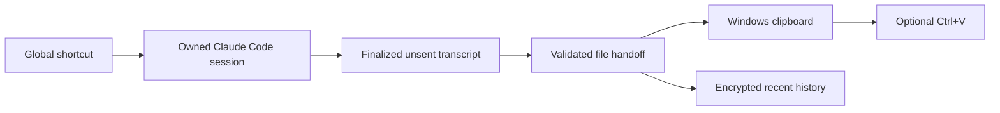

<p align="center">
  
</p>

<h1 align="center">Murmur</h1>
<p align="center"><strong>A tiny Windows dictation companion.</strong><br>Press Ctrl+Space. Speak. Your words, wherever you're working.</p>
<p align="center">
  <a href="https://github.com/AkshayReddyGujjula/murmur/releases"></a>
  <a href="https://github.com/AkshayReddyGujjula/murmur/actions/workflows/checks.yml"></a>
  <a href="https://github.com/AkshayReddyGujjula/murmur/releases"></a>
</p>

<h2 align="center">
  <a href="https://github.com/AkshayReddyGujjula/murmur/releases/latest/download/Murmur-Setup.exe">⬇ Download Murmur for Windows</a>
</h2>
<p align="center"><sub>Murmur-Setup.exe · free · Windows 10 and 11 · beta</sub></p>

<p align="center">
  <a href="#install">Install</a> · <a href="#how-to-use">How to use</a> · <a href="#troubleshooting">Troubleshooting</a> · <a href="#for-the-curious">How it works</a>
</p>

<p align="center"></p>
<p align="center"><sub>Native renderer preview with simulated audio. The app follows your microphone level.</sub></p>

Murmur lets you talk instead of type, in any app. Press a shortcut, speak, and your words are ready to paste. It sits quietly next to the clock until you need it.

## What you need

- A Windows 10 or Windows 11 computer (64-bit).
- A microphone.
- An internet connection.
- A [Claude.ai](https://claude.ai) account. Voice dictation needs you to sign in with a Claude.ai account. An API key on its own does not work. See [Claude's voice dictation page](https://code.claude.com/docs/en/voice-dictation) for details.

Your voice is sent to Anthropic, the company behind Claude, to be turned into text. Murmur does not work offline.

## Install

1. **[Download Murmur-Setup.exe](https://github.com/AkshayReddyGujjula/murmur/releases/latest/download/Murmur-Setup.exe).**

   Your browser may say the file "isn't commonly downloaded". Choose **Keep** (in Edge, click the **…** menu next to the download first).

2. **Double-click Murmur-Setup.exe.**

   Windows will probably show a blue box that says **"Windows protected your PC"**. This is normal for small apps from independent makers. Click **More info**, then **Run anyway**.

   Murmur installs itself just for you. You don't need an administrator password. It adds **Murmur** to your Start menu.

3. **Follow Murmur's prompts.**

   - If you don't have Claude Code yet, Murmur asks if you want to install it. Click **Install Claude Code**. A window opens and installs it. Wait for it to finish. (If you click **Not now**, you can do it later from **Install Claude Code...** in Murmur's menu.)
   - Murmur shows a short welcome message, then opens a small sign-in window. Your browser opens so you can sign in to your Claude.ai account.
   - If the browser shows a code instead of finishing by itself, copy the code. Click the small Murmur sign-in window, right-click to paste, and press **Enter**.
   - The sign-in window closes by itself, and Murmur says **"You're all set!"**

That's it. Murmur uses its own separate Claude sign-in. It doesn't change any other Claude app you use.

## How to use

1. Click into any text box: an email, a document, a chat.
2. Press **Ctrl+Space**.
3. Wait for the little black pill with moving bars to appear, then speak.
4. Press **Ctrl+Space** again when you're done.
5. Press **Ctrl+V** to paste your words.

Want it to paste for you? Click the Murmur icon next to the clock and turn on **Auto paste**.

| Action | Result |
| --- | --- |
| **Ctrl+Space** | Start a take. Speak once the bars appear. |
| **Ctrl+Space** again | Finish, finalize and copy the transcript. |
| **Esc** while recording | Cancel and discard the take. |
| **Green tick** | The transcript was copied; automatic paste is also attempted when enabled. |
| **Red X** | The take or delivery failed. The tray menu keeps the explanation. |
| **Recent** in the tray menu | Copy a previous transcript again. |
| **Quit Murmur** | Close Murmur and its owned Claude child. |

Murmur is silent. It plays no sounds; the pill shows you what's happening.

## Troubleshooting

<details>
<summary><strong>I can't find the Murmur icon</strong></summary>

Windows often hides small icons. Click the **^** arrow next to the clock, at the bottom right of your screen. The Murmur icon is in there. You can drag it onto the taskbar to keep it visible.

You can also open **Murmur** from the Start menu. If it is already running, this shows you its status.

</details>

<details>
<summary><strong>"Claude did not start" or "Claude needs one-time setup"</strong></summary>

Most new installs never see this. It can happen if you used an older Murmur before.

1. Click the Murmur icon (look under the **^** arrow next to the clock).
2. Choose **Account → Run Claude first-time setup...** (Murmur may open this window for you.)
3. Answer the questions in the window. When it asks whether you trust the folder, choose **"Yes, I trust this folder"**. The highlight starts on **"No, exit"**, so press the **↓** (down arrow) key once, then press **Enter**.
4. When the window shows an empty box to type in, setup is done. Just close that window.

If it asks you to sign in, use **Account → Sign in to Claude...** in the same menu.

</details>

<details>
<summary><strong>Nothing happens when I speak (microphone blocked)</strong></summary>

Open Windows **Settings › Privacy & security › Microphone**. Turn on **Microphone access** and **Let desktop apps access your microphone**. Then try again.

Also check that the right microphone is chosen in **Settings › System › Sound**.

</details>

<details>
<summary><strong>Ctrl+Space doesn't work (shortcut in use)</strong></summary>

Another app may already use Ctrl+Space. Click the Murmur icon, open **Shortcut**, and pick a different one, such as **Ctrl+Shift+Space**.

</details>

<details>
<summary><strong>How do I update Murmur?</strong></summary>

1. Click the Murmur icon and choose **Quit Murmur**.
2. [Download the newest Murmur-Setup.exe](https://github.com/AkshayReddyGujjula/murmur/releases/latest/download/Murmur-Setup.exe) and double-click it.

Your settings and sign-in are kept. If you forget to quit first, Murmur will remind you.

</details>

<details>
<summary><strong>How do I uninstall Murmur?</strong></summary>

1. Click the Murmur icon. Under **Options**, turn off **Start with Windows** if it is on.
2. Choose **Quit Murmur**.
3. Press **Windows key + R**, type `%LOCALAPPDATA%`, and press Enter. In the folder that opens, delete the **Murmur** folder. This also removes Murmur's settings, history and sign-in.
4. Remove the Start menu shortcut: press **Windows key + R**, type `shell:programs`, press Enter, and delete **Murmur**.

Claude Code itself is a separate program and stays installed.

</details>

---

## For the curious

Everything below is technical detail. You don't need it to use Murmur.

Murmur lives in the system tray and turns a global shortcut into dictation for the text field you're already using. A small black pill shows when it's listening. Finish your take and it collapses into a green tick; enable **Auto paste** to have the words pasted for you.

Transcription comes from the voice feature included in **Claude Code**, running in a separate Murmur-owned session. Murmur adds the desktop shortcut, visual feedback, clipboard handoff and optional automatic paste. It never submits the transcript as an agent prompt.

<details>
<summary><strong>Technical requirements and install details</strong></summary>

- Windows 10 1809 or later on x64, with .NET Framework 4.8 (included with Windows 10 version 1903 and later, and Windows 11).
- A native [Claude Code installation](https://code.claude.com/docs/en/setup) at `%USERPROFILE%\.local\bin\claude.exe`. If it is missing, Murmur offers to run Anthropic's official installer (`irm https://claude.ai/install.ps1 | iex`) in a visible window. Run `claude --version` to check your installation. Compatibility has been exercised with Claude Code **2.1.327**; CLI changes may require a Murmur update.
- `Murmur-Setup.exe` is the app itself. When started from anywhere other than `%LOCALAPPDATA%\Murmur`, it copies itself to `%LOCALAPPDATA%\Murmur\Murmur.exe`, creates a Start menu shortcut and starts the installed copy. No administrator access, PowerShell or Node.js is needed. Existing Murmur data is preserved during updates.
- Each release also has a ZIP containing the same `Murmur.exe`, an `Install.ps1` alternative installer (`.\Install.ps1 -Launch`), a readme and checksums. SHA-256 files are published beside each download.
- Murmur is unsigned beta software, which is why SmartScreen warns about it. Some development environments label build files as Low integrity, which blocks tray registration and automatic input; installing writes a fresh copy into your normal user app directory and does not change system security settings.
- Startup failures show a diagnostic file location. Use **Open logs folder** in the tray menu to find it.

</details>

<details>
<summary><strong>Automatic paste and destination</strong></summary>

Turn on **Auto paste** in the main tray menu. It is off by default. Murmur sends **Ctrl+V**, without pressing Enter, once the transcript is copied. If shortcut modifiers are still held, it briefly waits for release.

Under **Options → Paste destination**, choose:

- **Window focused when transcription finishes**: paste into the currently focused application. This is the default.
- **Window where dictation started**: paste only if that original window is still focused.

A focus or clipboard change before delivery cancels automatic paste. If the clipboard still contains the transcript, you can paste manually. Otherwise, recover it from **Recent**. Windows may block injected input into elevated applications.

</details>

<details>
<summary><strong>Shortcuts, engine modes and other options</strong></summary>

| Setting | Choices |
| --- | --- |
| Shortcut | Ctrl+Space, Ctrl+Shift+Space, Ctrl+Alt+Space, Alt+Shift+Space |
| Claude engine | Always ready, sleep after 15 minutes idle, or start on demand |
| Overlay | Bottom or top of the screen |
| Feedback | Silent visual indicators, Esc cancellation, Windows animation preference |
| History | Keep recent transcripts or disable history |
| Startup | Start with Windows |

**Always ready** is the default: it keeps the Claude child resident for quicker starts. Sleeping or starting on demand reduces idle memory, with a startup delay on the next take. Preferences survive restarts.

Feedback is visual only. Murmur plays no start, stop or error chimes; its tray notifications request silent delivery, and diagnostic dialogs have no alert sound.

The overlay is click-through and never takes keyboard focus. Its 27 separated bars respond to audio with smooth motion; strong peaks can reach close to the pill's edges. The visual meter does not change transcription accuracy.

</details>

### How it works



Murmur uses a Windows pseudoconsole to host its own Claude process. It holds the dictation key, waits for final text, and exports the unsent composer through Claude's external-editor handoff. Each take has an ID so late results from a cancelled take cannot be delivered.

The microphone meter is a visual aid. The overlay timer stops while hidden, rendering surfaces are reused, and only the owned child is managed. The completed transcript reaches the clipboard before history is encrypted and saved; completion polling is more frequent while the transcript settles and exports.

<details>
<summary><strong>Privacy and data</strong></summary>

- **Audio:** Claude Code sends dictation audio to Anthropic for transcription. This is not offline speech recognition. [Provider documentation](https://code.claude.com/docs/en/voice-dictation) explains its requirements and data handling.
- **Claude sessions:** Murmur uses a separate profile. It does not read or copy your existing Claude credentials or operate your other Claude sessions.
- **Clipboard:** completed text is copied to the Windows clipboard. Optional auto-paste sends Ctrl+V to the selected foreground window.
- **Recent history:** encrypted with Windows DPAPI for your Windows user. You can disable or clear it from the tray menu.
- **Logs:** lifecycle events and errors, without transcript text.
- **Downloads:** release files contain the application, installer, readme and checksums. They contain no profile, sign-in, settings, history or logs.

Fresh installs store data in `%LOCALAPPDATA%\Murmur\data`. An existing installation may use a data folder recorded in `%LOCALAPPDATA%\Murmur\data-location.txt`. Use **Open logs folder** in the menu to find its active app-data folder.

</details>

<details>
<summary><strong>Build it yourself</strong></summary>

Windows x64, Node.js, and the in-box .NET Framework C# compiler are enough. There are no NuGet or npm application dependencies.

```powershell
git clone https://github.com/AkshayReddyGujjula/murmur.git
cd murmur
node scripts/build.mjs test            # offline component and lifecycle checks
node scripts/test-conpty.mjs           # native redirected-launcher regression
node scripts/build.mjs build           # creates build\Murmur.exe
node scripts/package.mjs               # creates Murmur-Setup.exe, the Windows ZIP and SHA-256 files
node scripts/install.mjs --launch      # installs your local build
```

The source installer preserves an existing `build\data` location through `data-location.txt`. Keep that folder in place after installation.

The native regression launches only its own test child. Offline checks do not start Claude, open a microphone or write the clipboard. GitHub Actions runs the checks and packages a downloadable artifact on Windows. Pushing a `v*` tag that matches `VERSION` publishes a GitHub release with `Murmur-Setup.exe`, the ZIP and checksums.

| Folder | Responsibility |
| --- | --- |
| `src/App/Engine` | Dictation lifecycle and terminal interpretation |
| `src/App/Ui` | Tray menu, waveform and layered overlay |
| `src/App/Core` | Settings, clipboard, history and shortcuts |
| `src/App/Audio` | Microphone level meter |
| `src/Transport` | Owned process, pseudoconsole and bounded I/O |
| `src/Handoff` | Validated transcript publication |
| `src/Probe` | Isolated feasibility and diagnostic harness |

For details, see [module contracts](docs/APP-CONTRACTS.md), [manual acceptance checks](docs/APP-CHECKS.md), and [completion-latency notes](docs/LATENCY-2026-11-03.md).

</details>

### Beta status

The current implementation has **492 engine assertions**, **389 UI checks**, and startup, audio, clipboard-guard and handoff coverage. One existing link/reparse fixture is skipped when link creation is unavailable. These are offline checks, not an accuracy benchmark.

Short and 2+ minute live dictation and the desktop flow have been exercised. Recognition accuracy depends on Claude and the recording environment. Continuous 5–7 minute capture, actual frame pacing and end-to-end latency improvements are not guaranteed. The integration depends on Claude's terminal behavior and may need updates when its CLI changes.

Murmur is an independent project and is not affiliated with Anthropic. To report an issue, include Windows and Claude Code versions, the affected step, and a sanitized error message. Keep transcripts and account data out of public issue reports.
