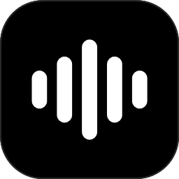
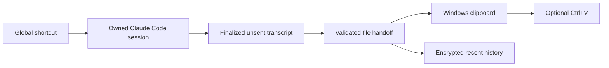

<p align="center">
  
</p>

<h1 align="center">Murmur</h1>
<p align="center"><strong>A tiny Windows dictation companion.</strong><br>Press Ctrl+Space. Speak. Your words, wherever you're working.</p>
<p align="center">
  <a href="https://github.com/AkshayReddyGujjula/murmur/releases"></a>
  <a href="https://github.com/AkshayReddyGujjula/murmur/actions/workflows/checks.yml"></a>
  <a href="https://github.com/AkshayReddyGujjula/murmur/releases"></a>
</p>
<p align="center">
  <a href="#get-started">Get started</a> · <a href="#using-murmur">Using Murmur</a> · <a href="#how-it-works">How it works</a> · <a href="#build-it-yourself">Build it yourself</a>
</p>

<p align="center"></p>
<p align="center"><sub>Native renderer preview with simulated audio. The app follows your microphone level.</sub></p>

Murmur lives in the system tray and turns a global shortcut into dictation for the text field you're already using. A small black pill shows when it's listening. Finish your take and it collapses into a green tick; enable **Auto paste** to have the words pasted for you.

Transcription comes from the voice feature included in **Claude Code**, running in a separate Murmur-owned session. Murmur adds the desktop shortcut, visual feedback, clipboard handoff and optional automatic paste. It never submits the transcript as an agent prompt.

## Get started

**You need:** Windows 10 1809 or later on x64, .NET Framework 4.8, a local microphone, internet access, and a native [Claude Code installation](https://code.claude.com/docs/en/setup). Claude dictation requires a Claude.ai account; an API key alone does not enable it. See [Claude's voice requirements](https://code.claude.com/docs/en/voice-dictation).

1. **[Download the Windows ZIP](https://github.com/AkshayReddyGujjula/murmur/releases)** and extract it.
2. Quit any running Murmur. In PowerShell, open the extracted folder and run:

   ```powershell
   .\Install.ps1 -Launch
   ```

3. Open Murmur's tray menu, including the Windows hidden-icons panel, then choose **Account → Sign in to Claude**. Complete **Run Claude first-time setup** if requested. This is Murmur's own sign-in.
4. Click into a text field. Press **Ctrl+Space**, wait for the waveform, and speak. Press **Ctrl+Space** again to finish, then **Ctrl+V** to paste.

The installer creates a Start menu shortcut and installs into `%LOCALAPPDATA%\Murmur`. Administrator access and Node.js are not required for the downloaded package. Existing Murmur data is preserved during updates.

<details>
<summary><strong>Prefer to build from source?</strong></summary>

Install Node.js and Git, then:

```powershell
git clone https://github.com/AkshayReddyGujjula/murmur.git
cd murmur
node scripts/build.mjs build
node scripts/install.mjs --launch
```

Murmur expects the native Claude executable at `%USERPROFILE%\.local\bin\claude.exe`. Run `claude --version` to check your Claude installation. Compatibility has been exercised with Claude Code **2.1.317**; CLI changes may require a Murmur update.

The source installer preserves an existing `build\data` location through `data-location.txt`. Keep that folder in place after installation. Fresh release installs store data in `%LOCALAPPDATA%\Murmur\data`.

</details>

<details>
<summary><strong>Windows blocks the installer script, or the icon is missing?</strong></summary>

Murmur is unsigned beta software. If your local policy prevents running PowerShell scripts, you can run the extracted `Murmur.exe` directly from a normal writable folder. Keep that folder in place because portable data lives beside the executable.

Some development environments label build files as Low integrity. Windows then blocks their tray registration and automatic input. The installer writes a fresh copy into your normal user app directory; it does not change system security settings.

Look in the hidden-icons panel. Reopening Murmur reveals the running instance's status. Startup failures show a diagnostic file location. If Claude is missing, check the expected path above. If your shortcut is already in use, choose another shortcut in Murmur's menu.

</details>

## Using Murmur

| Action | Result |
| --- | --- |
| **Ctrl+Space** | Start a take. Speak once the bars appear. |
| **Ctrl+Space** again | Finish, finalize and copy the transcript. |
| **Esc** while recording | Cancel and discard the take. |
| **Green tick** | The transcript was copied; automatic paste is also attempted when enabled. |
| **Red X** | The take or delivery failed. The tray menu keeps the explanation. |
| **Recent** in the tray menu | Copy a previous transcript again. |
| **Quit Murmur** | Close Murmur and its owned Claude child. |

The overlay is click-through and never takes keyboard focus. Its 27 separated bars respond to audio with smooth motion; strong peaks can reach close to the pill's edges. The visual meter does not change transcription accuracy.

<details>
<summary><strong>Automatic paste and destination</strong></summary>

Turn on **Auto paste** in the main tray menu. It is off by default. Murmur sends **Ctrl+V**, without pressing Enter, once the transcript is copied. If shortcut modifiers are still held, it briefly waits for release.

Under **Options → Paste destination**, choose:

- **Window focused when transcription finishes**: paste into the currently focused application. This is the default.
- **Window where dictation started**: paste only if that original window is still focused.

A focus or clipboard change before delivery cancels automatic paste. If the clipboard still contains the transcript, you can paste manually. Otherwise, recover it from **Recent**. Windows may block injected input into elevated applications.

</details>

<details>
<summary><strong>Shortcuts, engine modes and other options</strong></summary>

| Setting | Choices |
| --- | --- |
| Shortcut | Ctrl+Space, Ctrl+Shift+Space, Ctrl+Alt+Space, Alt+Shift+Space |
| Claude engine | Always ready, sleep after 15 minutes idle, or start on demand |
| Overlay | Bottom or top of the screen |
| Feedback | Sounds, Esc cancellation, Windows animation preference |
| History | Keep recent transcripts or disable history |
| Startup | Start with Windows |

**Always ready** is the default: it keeps the Claude child resident for quicker starts. Sleeping or starting on demand reduces idle memory, with a startup delay on the next take. Preferences survive restarts.

</details>

## How it works



Murmur uses a Windows pseudoconsole to host its own Claude process. It holds the dictation key, waits for final text, and exports the unsent composer through Claude's external-editor handoff. Each take has an ID so late results from a cancelled take cannot be delivered.

The microphone meter is a visual aid. The overlay timer stops while hidden, rendering surfaces are reused, and only the owned child is managed. The completed transcript reaches the clipboard before history is encrypted and saved; completion polling is more frequent while the transcript settles and exports.

<details>
<summary><strong>Privacy and data</strong></summary>

- **Audio:** Claude Code sends dictation audio to Anthropic for transcription. This is not offline speech recognition. [Provider documentation](https://code.claude.com/docs/en/voice-dictation) explains its requirements and data handling.
- **Claude sessions:** Murmur uses a separate profile. It does not read or copy your existing Claude credentials or operate your other Claude sessions.
- **Clipboard:** completed text is copied to the Windows clipboard. Optional auto-paste sends Ctrl+V to the selected foreground window.
- **Recent history:** encrypted with Windows DPAPI for your Windows user. You can disable or clear it from the tray menu.
- **Logs:** lifecycle events and errors, without transcript text.
- **Downloads:** release packages contain the application, installer, readme and checksums. They contain no profile, sign-in, settings, history or logs.

An existing installation may use a data folder recorded in `%LOCALAPPDATA%\Murmur\data-location.txt`. Use **Open logs folder** in the menu to find its active app-data folder.

</details>

## Build it yourself

Windows x64, Node.js, and the in-box .NET Framework C# compiler are enough. There are no NuGet or npm application dependencies.

```powershell
node scripts/build.mjs test            # offline component and lifecycle checks
node scripts/test-conpty.mjs           # native redirected-launcher regression
node scripts/build.mjs build           # creates build\Murmur.exe
node scripts/package.mjs               # creates the Windows ZIP and SHA-256 file
```

The native regression launches only its own test child. Offline checks do not start Claude, open a microphone or write the clipboard. GitHub Actions runs the checks and packages a downloadable artifact on Windows.

| Folder | Responsibility |
| --- | --- |
| `src/App/Engine` | Dictation lifecycle and terminal interpretation |
| `src/App/Ui` | Tray menu, waveform and layered overlay |
| `src/App/Core` | Settings, clipboard, history and shortcuts |
| `src/App/Audio` | Microphone level meter |
| `src/Transport` | Owned process, pseudoconsole and bounded I/O |
| `src/Handoff` | Validated transcript publication |
| `src/Probe` | Isolated feasibility and diagnostic harness |

For details, see [module contracts](docs/APP-CONTRACTS.md), [manual acceptance checks](docs/APP-CHECKS.md), and [completion-latency notes](docs/LATENCY-2026-11-03.md).

## Beta status

The current implementation has **436 engine assertions**, **381 UI checks**, and startup, audio, clipboard-guard and handoff coverage. One existing link/reparse fixture is skipped when link creation is unavailable. These are offline checks, not an accuracy benchmark.

Short live dictation and the desktop flow have been exercised. Recognition accuracy depends on Claude and the recording environment. Continuous 5–7 minute capture, actual frame pacing and end-to-end latency improvements are not guaranteed. The integration depends on Claude's terminal behavior and may need updates when its CLI changes.

Murmur is an independent project and is not affiliated with Anthropic. To report an issue, include Windows and Claude Code versions, the affected step, and a sanitized error message. Keep transcripts and account data out of public issue reports.
